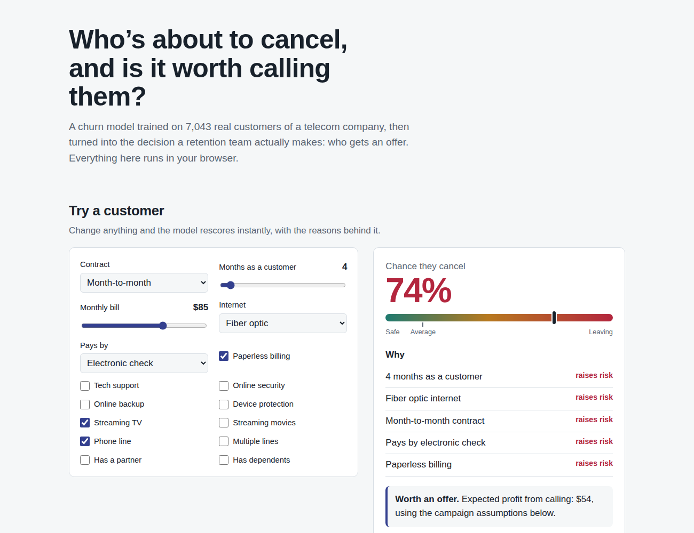
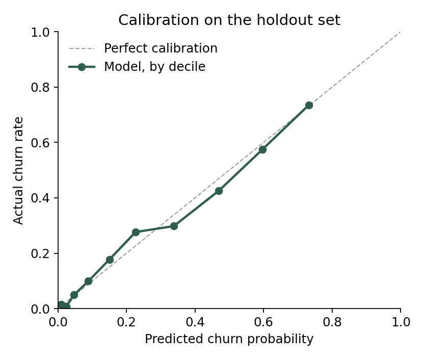
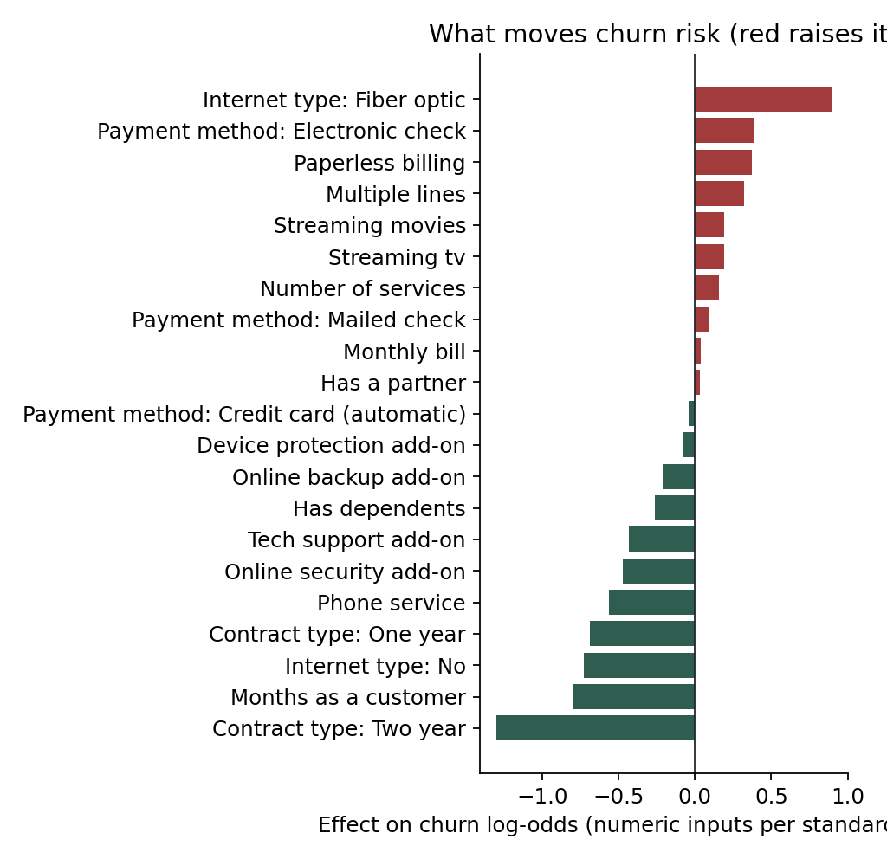
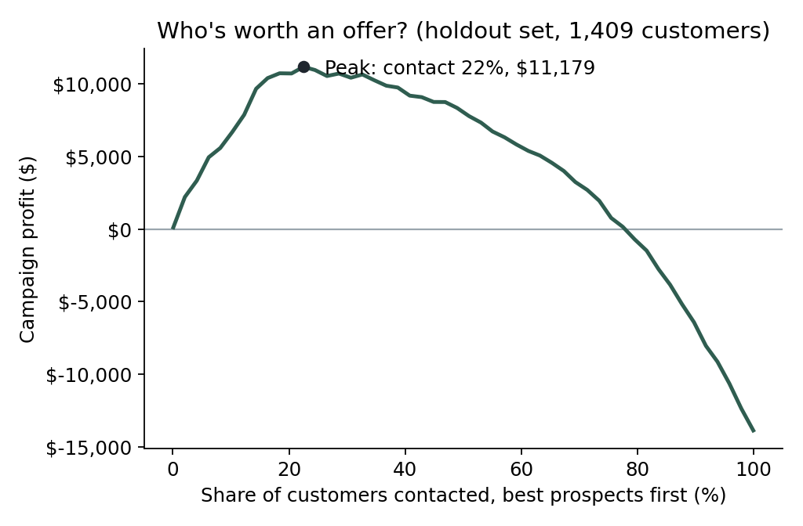

# Retention Targeting

A churn model on real telecom data, taken one step further than most: from "who might leave" to "who is worth a retention offer, and does the campaign pay." It ships as a page where you can score a customer, see the reasons, and replan the campaign under your own assumptions.

**Live:** _add your Vercel link here_ (static site, the model runs in the browser)



## The short version

- **Calling everyone loses money.** A blanket retention campaign on the 1,409 holdout customers loses $13,872, because most people who take a discount were never going to leave.
- **The model turns that into a profit.** Targeting with it earns about $10,747. Calling a random 20% loses $4,413.
- **Two good targeting rules tie, and I say so.** "Call the riskiest 20%" ($10,801) and "call anyone with positive expected value" ($10,747) are statistically indistinguishable at the baseline assumptions. A 2,000-sample bootstrap of the difference has a 95% interval of −$1,636 to $1,699.
- **The expected-value rule earns its keep when assumptions move.** If offers only change 10% of minds, it shrinks the campaign and still makes $707, while the fixed 20% loses $522. At 50%, it makes $26,202 against $22,123. It wins 8 of 14 sensitivity scenarios.
- **The shipped model leaves age out on purpose.** Adding the senior-citizen flag would buy 0.0013 AUC. For a model that decides who gets a discount, that's not worth age-based targeting.

## Data

The [IBM Telco Customer Churn sample](https://raw.githubusercontent.com/IBM/telco-customer-churn-on-icp4d/master/data/Telco-Customer-Churn.csv): 7,043 customers, 21 columns, a 26.5% churn rate, published by IBM under the Apache 2.0 license. It's a well-known benchmark, which is a reason to use it: results here can be compared with everyone else's. It's also a reason to do more than train three models in a notebook, since that's what most projects with this data stop at.

One real defect: `TotalCharges` is stored as text, and it's blank for 11 customers. All 11 have a tenure of zero, meaning they signed up and haven't been billed yet. The usual fix is to drop them. Here they're set to $0, which is the true value, and an assertion fails the build if a blank ever shows up for anyone else.

## Choosing a model

Five-fold stratified cross-validation, on the training split only:

| Model | ROC AUC | PR AUC | Brier score (lower is better) |
|---|---|---|---|
| Random forest | 0.846 ± 0.010 | 0.660 | 0.135 |
| **Logistic regression (shipped)** | **0.845 ± 0.012** | **0.660** | **0.135** |
| Gradient boosting | 0.839 ± 0.010 | 0.653 | 0.138 |

The gap between the top two is smaller than the variation between folds. Logistic regression went out because it's as accurate, its probabilities are well calibrated, every prediction can be broken into reasons, and it's small enough to run on a web page. On the untouched holdout set it scores ROC AUC 0.838 and PR AUC 0.630, against a 26.5% base rate.





The drivers are what a retention team would expect, which is a good sign: month-to-month contracts, short tenure, fiber internet, and paying by electronic check raise risk. Long contracts and tech support lower it.

## From scores to decisions

A churn probability doesn't say who to call. An offer costs money every time it's accepted, including by customers who were going to stay anyway. `src/business.py` puts a value on contacting each customer:

```
expected profit = P(churn) × save rate × value of keeping them
                − contact cost
                − (P(churn) × save rate + P(stay) × stayer acceptance) × offer cost
```

The assumptions are stated where anyone can argue with them: a 40% margin, 12 months of value for a saved customer, offers that keep 30% of would-be leavers, a free month as the offer, 60% of stayers taking it anyway, and $5 per contact. Every one of them is a slider on the live page.



The curve rises while offers reach customers who were really leaving, peaks, then falls as offers pile up on people who would have stayed. In hindsight, the best cutoff on this holdout was a little lower than the one the expected-value rule picked without seeing outcomes, which is the honest cost of not having a crystal ball.

## Fairness

Gender isn't a model input. Age was tested and left out. The holdout results by group:

| Group | Customers | Actually churned | Predicted | ROC AUC | Offered a deal |
|---|---|---|---|---|---|
| Female | 687 | 28.1% | 26.8% | 0.835 | 32% |
| Male | 722 | 25.1% | 26.8% | 0.843 | 30% |
| Under 65 | 1,187 | 23.3% | 24.3% | 0.839 | 27% |
| Senior | 222 | 44.1% | 40.1% | 0.783 | 53% |

Seniors churn far more (44% against 23%), and they get offers about twice as often, because the model sees their risk through other signals. Leaving age out has a cost, though: the model under-predicts senior churn by about 4 points and ranks seniors less sharply (AUC 0.783). I'd raise that with the business rather than quietly add age back.

## The browser model

The simulator doesn't call a server. `src/build.py` exports the fitted pipeline's encoder levels, scaler parameters, and coefficients to `site/model.json`, and `site/score.js` reimplements prediction in about 30 lines. `tests/parity.test.mjs` checks it against scikit-learn on 40 real customers, to within 10⁻⁹. It also checks that the per-customer reasons add up exactly to the difference between that customer's score and the average customer's.

Explanations come straight from the model: each input's effect on the log-odds, compared with the average customer, summed per field. A logistic model makes that exact, which is part of why it was chosen.

## Running it

```bash
pip install -r requirements.txt
python -m src.build        # trains, evaluates, writes results/, docs/ figures, and site/ data
pytest -q
node --test tests/parity.test.mjs

python -m http.server --directory site 8000
```

To deploy, import the repo into Vercel with the root directory set to `site`. It's static, so there's no build step.

## What this can't tell you

- **Save rate and acceptance rate are guesses.** The only way to know them is to run a randomized test: offer half the at-risk customers a deal and compare what happens. Until then, read the profit figures as a range.
- **Predicting who leaves isn't predicting who an offer keeps.** The right next model is an uplift model trained on that test, which targets persuadable customers directly.
- **This is one snapshot.** A production system would score customers on a schedule, watch for drift, and retrain when the population changes.
